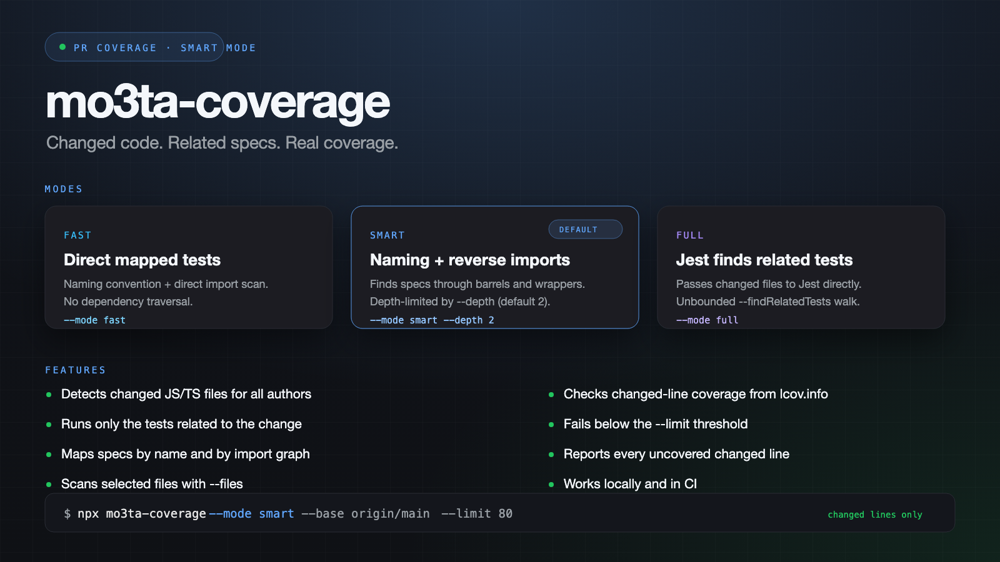

# mo3ta-coverage 



mo3ta-coverage checks coverage for changed lines in a pull request. It finds changed source files, maps them to likely test files, runs Jest in a selected execution mode, and validates changed-line coverage against a threshold.

## Features

- Detects changed JS/TS files from git history and working tree, for all authors
- Accepts an explicit file list (`--files` / `--filesFrom`) to control what gets scanned
- Maps changed source files to related test files, even when names differ
- Supports three execution modes: `fast`, `smart`, and `full`
- Walks reverse imports in `smart` mode to a configurable depth (default `2`)
- Parses `lcov.info` and reports uncovered changed lines
- Enforces a minimum coverage threshold for changed lines

## Installation

```sh
npm install -g mo3ta-coverage
```

## Usage

```sh
mo3ta-coverage --mode smart --base origin/main --limit 80
```

## CLI Options

| Option | Description | Default |
|--------|-------------|---------|
| `--base <branch>` | Base branch to compare against | `origin/main` |
| `--lcov <path>` | Path to `lcov.info` | `coverage/lcov.info` |
| `--limit <percent>` | Minimum changed-line coverage percentage | `80` |
| `--showCovered <bool>` | Show covered changed lines in output | `false` |
| `--mode <mode>` | Execution mode: `fast`, `smart`, or `full` | `smart` |
| `--depth <number>` | Max reverse-import depth used by `smart` (`1` or `2` recommended) | `2` |
| `--files <files...>` | Scan only these files instead of auto-detecting changed files (space- or comma-separated) | – |
| `--filesFrom <path>` | Read the file list to scan from a newline-separated file | – |

## Scanning Selected Files

Changed files are detected from git for **all authors**, not just the current
git user. If you want to control exactly which files are scanned, pass them
directly. The library still maps them to tests and checks changed-line coverage.

```sh
# Explicit list (space-separated)
mo3ta-coverage --files src/a.js src/b.ts --base origin/main

# Explicit list (comma-separated)
mo3ta-coverage --files src/a.js,src/b.ts --base origin/main

# From a file containing one path per line
git diff --name-only origin/main > changed.txt
mo3ta-coverage --filesFrom changed.txt --base origin/main
```

Explicitly provided files skip git changed-file detection. Their changed lines
are still computed against `--base`, so only lines that differ from the base
branch are counted toward coverage.

## Modes

- `fast`: Naming-convention matches only, plus a direct import-scan fallback. No dependency traversal.
- `smart`: Naming-convention matches plus a reverse-import walk from each changed file, limited by `--depth`. This finds spec files whose names differ and tests that reach the changed file through intermediate modules such as barrel `index.js` files. No Jest dependency traversal.
- `full`: Passes the changed source and test files to `jest --findRelatedTests`, letting Jest traverse without a depth limit.

### Depth in `smart` mode

One depth step is one import edge:

- `--depth 1`: test files that import the changed file directly.
- `--depth 2` (default): also test files that import a module which imports the changed file.

Depth `2` is usually the sweet spot: it catches barrel/re-export and thin wrapper
layers without pulling in the whole dependency graph.

## Recommended Mode

For most projects, especially large ones with shared helpers or deep import graphs, use:

```sh
mo3ta-coverage --mode smart --base origin/main --limit 80
```

Use `full` only when you intentionally want Jest to expand to related tests.

## Configuration

You can persist defaults with the `config` subcommand:

```sh
mo3ta-coverage config --base origin/main --mode smart --depth 2
```

This writes `.mo3ta-coverage.json` in the project root.

## How It Works

1. Reads CLI options and saved config from [index.js](index.js).
2. Finds changed source files from git in [src/cli.js](src/cli.js).
3. Maps source files to related test files in [src/fileUtils.js](src/fileUtils.js).
   `smart` mode combines naming conventions with a cached reverse-import index
   and walks it up to `--depth` edges.
4. Runs Jest in the selected mode from [src/cli.js](src/cli.js).
5. Parses `lcov.info` and reports uncovered changed lines.

## Development

```sh
npm install
npm test
```

## License

MIT
